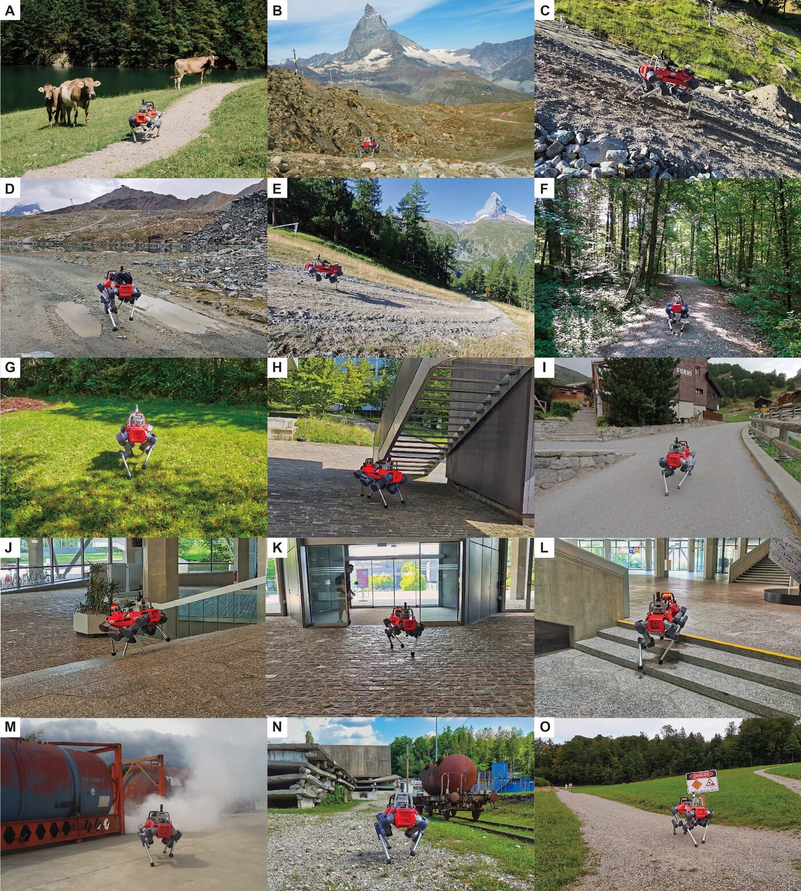
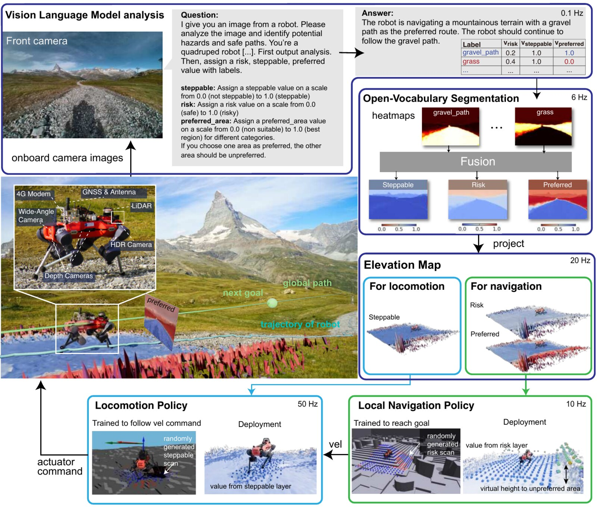
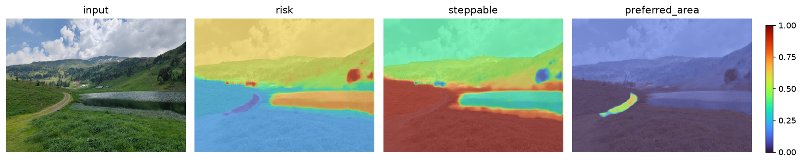
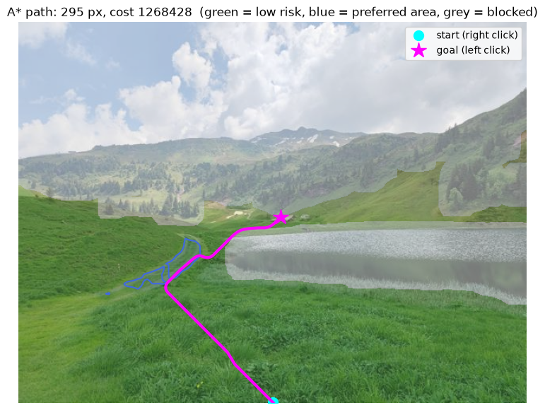
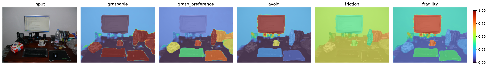

# ROAM

Code for **Bridging vision-language reasoning and learned control for legged navigation in the wild**,
*Science Robotics* (2026). [Paper (DOI)](https://doi.org/10.1126/scirobotics.aee1549)

Takahiro Miki, Robin Schmid, Manthan Patel, Turcan Tuna, Julia Richter, Julian Nubert, Joonho Lee,
Matthias Müller and Marco Hutter



ROAM uses a Vision-Language Model (VLM) to read the scene in front of a legged robot and
assign each terrain class a **risk**, **steppable** and **preferred area** value. An
open-vocabulary segmentation network (SAN) then turns those labels into dense per-pixel maps
that are fused into an elevation map for the robot's locomotion and navigation policies.



*The ROAM pipeline (Fig. 1 of the paper). This repository covers the VLM analysis and the
open-vocabulary segmentation, and feeds the semantic images into elevation_mapping_cupy
(see [`examples/elevation_mapping`](examples/elevation_mapping)).*

This repository contains three packages:

| Package | What it is |
|---|---|
| [`vlm_nav`](vlm_nav) | Pure Python library: prompt generation with short-term memory, VLM clients (OpenAI and Google Gemini, with schema-validated output), SAN segmentation, the label → value map conversion, and an image-space A* planner on the risk map. |
| [`vlm_nav_ros`](vlm_nav_ros) | ROS 2 node that runs `vlm_nav` on camera streams and publishes the semantic value images. |
| [`vlm_nav_ros1`](vlm_nav_ros1) | The same node for ROS 1 (Noetic). |

## Installation

Install PyTorch for your CUDA version first by following the [official instructions](https://pytorch.org/get-started/locally/).

```bash
git clone git@github.com:leggedrobotics/roam.git
cd roam/vlm_nav
pip3 install -e .   # Gemini (default) and OpenAI models; Gemini needs Python 3.9+
```

The default VLM is `gemini-4-hydrogen` with thinking turned off, so labels come back quickly.
Set `GEMINI_API_KEY` (from [Google AI Studio](https://aistudio.google.com/apikey)), or pass an
OpenAI model such as `--vlm_model gpt-6.1-sol` with `OPENAI_API_KEY`. On Python 3.8 (ROS Noetic),
where google-genai does not install, Gemini models go through Gemini's OpenAI-compatible endpoint
with the same key.

### Segmentation backend

SAN can run as a separate server or in the same process. This is selected with
`--seg_model` in `example.py`, or `seg_model` in the ROS config.

**Server (`api`):** keeps detectron2 out of your environment. Needs Docker with GPU support.

```bash
./vlm_nav/bin/run_san_server.sh   # serves on http://localhost:7860
```

**In-process (`SAN`, the ROS default):** install [SAN](https://github.com/mktk1117/SAN) and
detectron2. The SAN weights are downloaded on first use.

```bash
git clone https://github.com/mktk1117/SAN.git && pip3 install ./SAN
pip3 install 'git+https://github.com/facebookresearch/detectron2.git@v0.6'
pip3 install -e "vlm_nav[san]"
```

### API keys

```bash
export OPENAI_API_KEY=<your key>   # for OpenAI models (gpt-*)
export GEMINI_API_KEY=<your key>   # for Gemini models (gemini-*, the default)
```

## Try it in the browser

[](https://colab.research.google.com/github/leggedrobotics/roam/blob/main/demo/vlm_nav_demo.ipynb)

[`demo/`](demo) is a Gradio app: upload a photo, get the VLM labels and the per-pixel maps, and click
to plan a path. The examples run without an API key. Run it in Colab with the badge above, or locally
with `python demo/app.py`.

## Quick start

```bash
cd vlm_nav
python3 example.py example_data/hiking_lake.jpg --seg_model api
```

This asks the VLM for labels, segments the image and shows one map per output field.
Useful flags: `--vlm_model` (any OpenAI `gpt-*` or Gemini `gemini-*` model ID, default `gemini-4-hydrogen`), `--save_images` (writes to `result/`),
`-d` (per-label heatmaps).

On the lake image, `gemini-4-hydrogen` marks the water, trees and buildings as risky, the grass as safe
but not preferred, and the dirt trail as the preferred path:



### Click-and-plan demo

```bash
pip3 install -e "vlm_nav[depth]"   # Depth Anything V2 via Hugging Face transformers
python3 example.py example_data/hiking_lake.jpg --seg_model api --save_images
python3 click_plan_demo.py example_data/hiking_lake.jpg --maps_dir result/hiking_lake
```

Left click a goal on the image and A* plans a path from the robot's feet (bottom centre; right click moves
the start). The cost per pixel is `1 + 100 * risk + 1000 * (1 - preferred_area)`, so the path sticks to
the preferred area but can leave it to reach a goal. Non-steppable ground is blocked and grown by a
10-pixel clearance. The cost is scaled by monocular depth so a far pixel costs as much as the ground it
covers. Drop `--maps_dir` to ask the VLM live, tune `--preferred_weight` (a negative value blocks
everything outside the preferred area) and `--inflate`, add `--no_depth` to plan on raw pixels, and pass
`--goal row,col --save plan.png` to run without a display. The planner itself is in
[`vlm_nav/vlm_nav/planning`](vlm_nav/vlm_nav/planning).

With a goal just behind the lake (`--goal 245,330`), the path crosses the grass to the trail, follows it
past the end of the lake, and keeps its distance from the water and reeds:



### Beyond risk: friction, grasping, push or pull

[`examples/property_maps`](examples/property_maps) uses the same pipeline to estimate other
properties: how slippery and how soft the ground is, where a gripper should grasp and what it
must avoid, which objects move, whether to push or pull them, and their rough mass. Each is a
few lines of config in `prompts.yaml`.



### Elevation map example

[`examples/elevation_mapping`](examples/elevation_mapping) replays 30 s of the Seealpsee hike (lidar,
camera poses and ROAM's semantic images) through
[elevation_mapping_cupy](https://github.com/leggedrobotics/elevation_mapping_cupy), so the risk,
steppable and preferred-area values become layers of a 2.5D map you can plan on. Needs a CUDA GPU.

The prompt is assembled from [`vlm_nav/config/prompts.yaml`](vlm_nav/config/prompts.yaml):
a task description, a robot description, analysis guidelines, and the output fields to
estimate. It is the prompt from the paper (the full prompt in the supplementary material), which
also tells the VLM to follow signs. The `nature_hiking` setup is the one used on ANYmal.

## ROS 2

```bash
# in your workspace src/
ln -s /path/to/roam/vlm_nav /path/to/roam/vlm_nav_ros .
cd .. && colcon build --symlink-install --packages-select vlm_nav vlm_nav_ros
ros2 launch vlm_nav_ros vlm_nav_ros.launch.py
```

`--symlink-install` matters: the node resolves a relative `vlm_nav_config_path` against the
`vlm_nav` source folder. Otherwise give an absolute path.

Configure cameras and models in [`vlm_nav_ros/config/vlm_nav_cfg.yaml`](vlm_nav_ros/config/vlm_nav_cfg.yaml).
For every entry in `sensor_configs` the node subscribes to `image_topic` (raw or compressed)
and `camera_info_topic`, and publishes:

| Topic | Content |
|---|---|
| `<output_topic_prefix>_sem` | Multi-channel image, one channel per output field (risk, steppable, preferred_area) |
| `<output_topic_prefix>_sem_viz` | Colorized visualization |
| `<camera_info_topic>_sem` | Camera info matching the semantic image |
| `~/labels`, `~/response` | Latest VLM labels (JSON) and raw response |
| `~/duration` | VLM query time |

To fuse the semantic images into an elevation map on the robot, use
`ros2 launch vlm_nav_ros vlm_nav_elevation_mapping.launch.py`, which also starts elevation_mapping_cupy
with [`vlm_nav_ros/config/elevation_mapping_vlm_nav.yaml`](vlm_nav_ros/config/elevation_mapping_vlm_nav.yaml)
(see [`examples/elevation_mapping`](examples/elevation_mapping) for the required elevation_mapping_cupy version).

The VLM is queried every `vlm_duration` seconds on the cameras in `vlm_sensor_names`;
segmentation runs every `segment_duration` seconds on all cameras with the latest labels.
Call `~/start_stop_vlm` (`std_srvs/SetBool`) to pause or resume VLM queries.

## ROS 1

[`vlm_nav_ros1`](vlm_nav_ros1) is the same node for ROS 1, with the same parameters, topics and service.

```bash
pip3 install -e /path/to/roam/vlm_nav   # into the Python that runs rospy (Noetic: 3.8)
# in your catkin workspace src/
ln -s /path/to/roam/vlm_nav_ros1 .
cd .. && catkin build vlm_nav_ros1
roslaunch vlm_nav_ros1 vlm_nav.launch
```

Configure it in [`vlm_nav_ros1/config/vlm_nav_cfg.yaml`](vlm_nav_ros1/config/vlm_nav_cfg.yaml) (private
parameters). A relative `vlm_nav_config_path` is resolved against the `vlm_nav` folder next to
`vlm_nav_ros1`, following symlinks. `roslaunch vlm_nav_ros1 vlm_nav_elevation_mapping.launch` also starts
elevation_mapping_cupy's ROS 1 node (`main` branch) with
[`vlm_nav_ros1/config/elevation_mapping_vlm_nav.yaml`](vlm_nav_ros1/config/elevation_mapping_vlm_nav.yaml).

## Citation

If you use this code, please cite:

```bibtex
@article{miki2026roam,
  title   = {Bridging vision-language reasoning and learned control for legged navigation in the wild},
  author  = {Miki, Takahiro and Schmid, Robin and Patel, Manthan and Tuna, Turcan and Richter, Julia and
             Nubert, Julian and Lee, Joonho and M{\"u}ller, Matthias and Hutter, Marco},
  journal = {Science Robotics},
  volume  = {11},
  pages   = {eaee1549},
  year    = {2026},
  doi     = {10.1126/scirobotics.aee1549}
}
```

## License

MIT, see [LICENSE](LICENSE).
