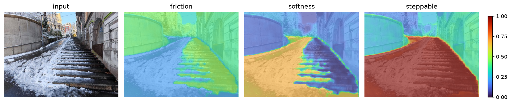
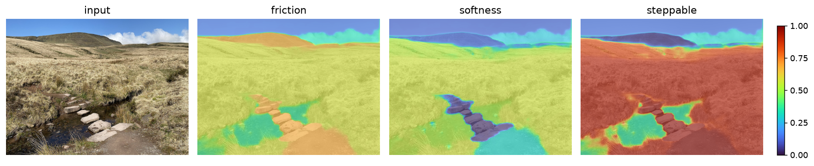
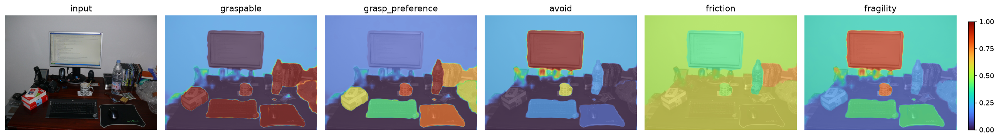
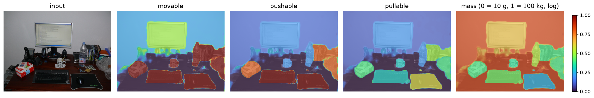

# Property maps beyond risk

ROAM asks a VLM for a short list of labels and a value per label for each output field, then
uses open-vocabulary segmentation to paint those values onto the image. Nothing in that pipeline
is specific to risk: an output field is just a name, a prompt and a default in
[`vlm_nav/config/prompts.yaml`](../../vlm_nav/config/prompts.yaml). These examples use the same
code to estimate other properties of a scene, for legged locomotion and for manipulation.

They are extra examples, not experiments from the paper. The paper's prompt is the
`nature_hiking` setup.

| Setup | Fields | What it answers |
|---|---|---|
| `terrain_properties` | `friction`, `softness`, `steppable` | Is the ground slippery? Does it give way under a foot? |
| `tabletop_manipulation` | `graspable`, `grasp_preference`, `avoid`, `friction`, `fragility` | What can the gripper pick up, where should it hold it, what must it not touch, and how gently? |
| `object_interaction` | `movable`, `pushable`, `pullable`, `mass` | What moves, should it be pushed or pulled, and roughly how heavy is it? |

`mass` uses a log scale so that a cup and a table fit on the same 0–1 map: 0.0 ≈ 10 g,
0.25 ≈ 100 g, 0.5 ≈ 1 kg, 0.75 ≈ 10 kg, 1.0 ≥ 100 kg.

## Terrain: friction and softness

Snow on the stairs comes out slippery and soft, while the bare stone steps are grippy and
rigid:



At a stream crossing, the stepping stones are the grippy, rigid and steppable path across;
the water around them is slippery and not steppable, and the grass on the banks is soft:



## Manipulation: where to grasp and what to avoid

The bottle, mug and mouse are the best grasp targets; the monitor is the one thing to avoid,
and also the most fragile:



## Manipulation: push or pull, and mass

On the desk, the keyboard and mouse are pushed, the small objects are light, and the desk
and wall are fixed and heavy:



## Run it

The figures use hand-written labels in
[`vlm_nav/example_data/labels`](../../vlm_nav/example_data/labels), so they need no API key,
only the SAN server (`vlm_nav/bin/run_san_server.sh`):

```bash
./examples/property_maps/run_examples.sh
```

To have the VLM write the labels instead:

```bash
export OPENAI_API_KEY=...          # or GEMINI_API_KEY
LIVE=1 VLM_MODEL=gemini-4-hydrogen ./examples/property_maps/run_examples.sh
```

One image with one setup:

```bash
cd vlm_nav
python3 example.py example_data/messy_desk.jpg -t tabletop_manipulation --seg_model api --softmax_temperature 0.05
```

## Notes

- **Sharper maps indoors.** Each pixel's value is a mix of the label values, weighted by the
  segmentation scores. Outdoors there are a few large regions and the default
  `softmax_temperature` of 0.3 works well. In a cluttered room many small objects get similar
  scores, so the mix blurs; the indoor examples use 0.05.
- **What the segmentation can and can't see.** SAN finds whole objects well but not small
  parts, such as individual drawers, handles, or plates inside a dish rack.
- **Writing a new property.** Add an entry under `output_fields` (a prompt, a `value`
  description and a `default`), then a setup that lists it. `element` names what a label
  stands for (`terrain element` by default, `object part` for manipulation); the response
  schema and the closing instruction use it.
